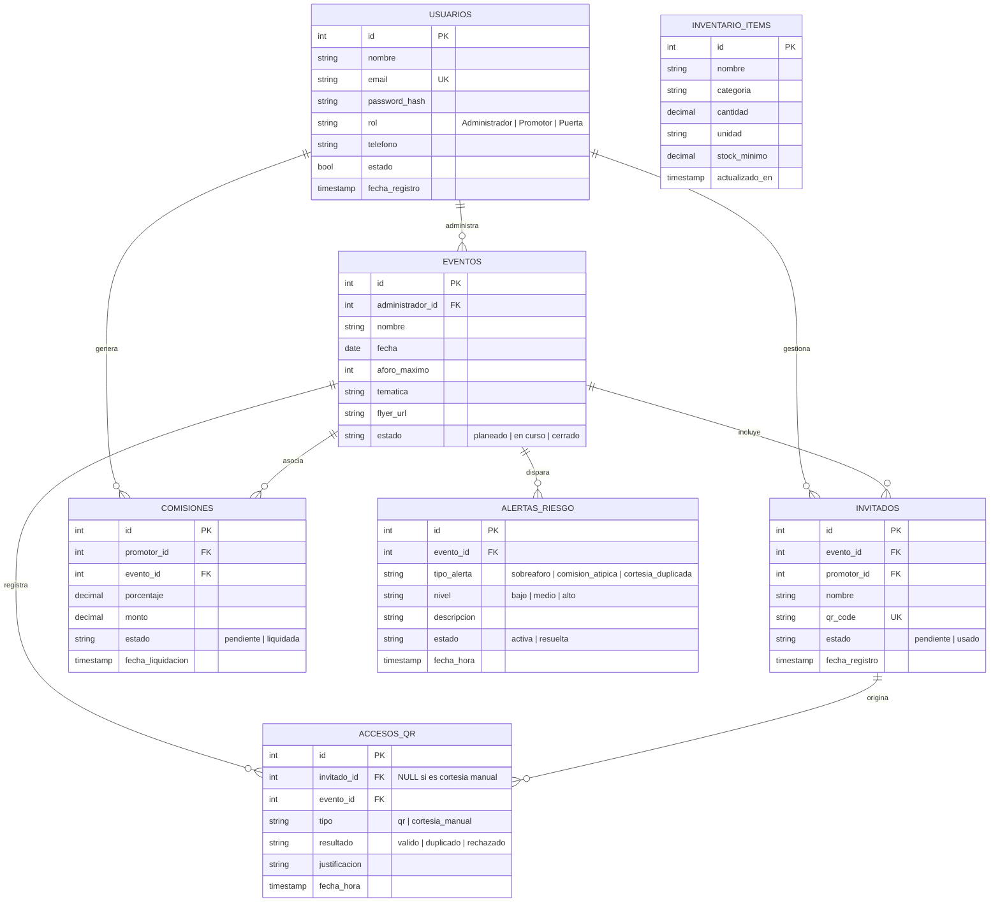

# Base de datos — Nightlife Data Scientist

PostgreSQL 14+. El esquema SQL plano incluye los campos actuales del proyecto;
para una base existente, las migraciones de Alembic son la fuente recomendada.

## Archivos

- `schema.sql`: DDL de referencia (tablas, llaves foráneas, `CHECK` constraints e
  índices) según el diccionario de datos del documento de grado (cap. 3.2).
- `seed.sql`: datos de demostración (1 administrador, 1 promotor, 1 usuario
  de puerta, 1 evento y 3 invitados con QR).

## Uso rápido

```bash
createdb nightlife_db
psql -U postgres -d nightlife_db -f Database/schema.sql
psql -U postgres -d nightlife_db -f Database/seed.sql
```

O, de forma equivalente, desde el backend (recomendado para desarrollo,
ya que además crea el primer administrador con contraseña hasheada
correctamente):

```bash
cd Backend
python -m alembic upgrade head
python -m scripts.seed_data
```

## Modelo Entidad-Relación



## Reglas de integridad clave

- `usuarios.email` único; `password_hash` nunca se expone vía API.
- `invitados.qr_code` único e inmutable una vez marcado `usado` (previene
  duplicación de cortesías).
- `eventos.aforo_maximo` > 0; el conteo de `accesos_qr` con `resultado =
  'valido'` no puede superarlo (se valida en la capa de aplicación,
  `AccesoService`, no sólo en base de datos).
- `comisiones.porcentaje` entre 0 y 100; `monto` >= 0.
- `inventario_items.cantidad` y `stock_minimo` no pueden ser negativos.
- Los campos de tipo enumerado (`rol`, `estado`, `tipo`, `resultado`,
  `tipo_alerta`, `nivel`) están restringidos con `CHECK` a los valores
  definidos en `Backend/app/domain/enums.py`, que es la fuente de verdad.
